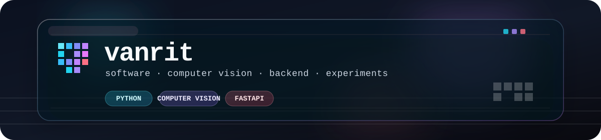
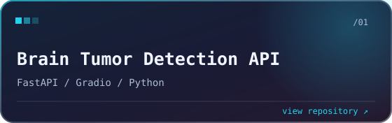
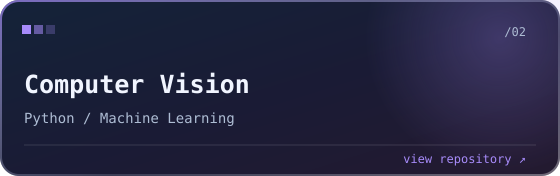
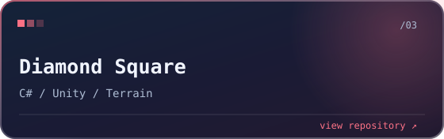
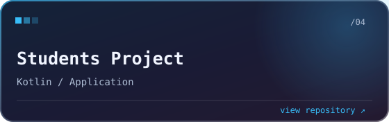
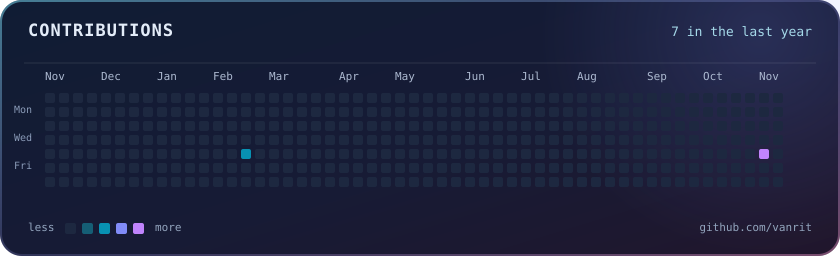

  

Building software, computer vision experiments, and practical backend tools.

  <code>Python</code> · <code>FastAPI</code> · <code>Computer Vision</code> · <code>C#</code> · <code>Kotlin</code> · <code>Unity</code>

### Selected work

<table>
  <tr>
    <td width="50%" valign="top">
      
    </td>
    <td width="50%" valign="top">
      
    </td>
  </tr>
  <tr>
    <td width="50%" valign="top">
      
    </td>
    <td width="50%" valign="top">
      
    </td>
  </tr>
</table>

### Contributions

  

<b>More about my stack</b>

 

**Languages:** Python, C#, Kotlin  
**Frameworks & tools:** FastAPI, Gradio, Unity, Jupyter  
**Interests:** machine learning, computer vision, backend, procedural generation

<a href="https://github.com/vanrit?tab=repositories">all repositories ↗</a>

